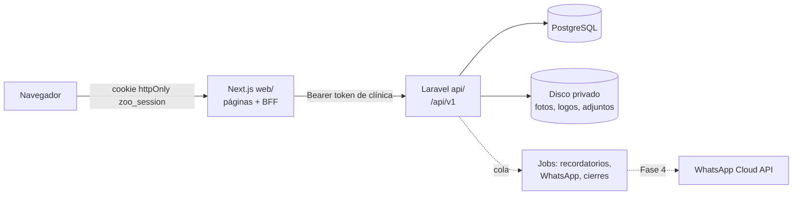

# Arquitectura

Cómo está armado Zooetia y por qué. Para montar el entorno ve a [`../README.md`](../README.md); para el día a día, a [`desarrollo.md`](desarrollo.md).

## 1. Vista general



- **Monorepo**: `api/` (Laravel 13, PHP 8.4) y `web/` (Next.js 16, React 19). Más adelante `mobile/`.
- **La API es la única que toca la base de datos.** Next.js no tiene acceso a PostgreSQL: todo pasa por `/api/v1`. Así la app móvil futura usa exactamente la misma API.
- **Next.js tiene dos papeles:** renderizar el dashboard y hacer de **BFF** (*backend for frontend*): guarda el token de Laravel en una cookie `httpOnly` y reenvía las llamadas. El JavaScript del navegador nunca ve el token (si hay un XSS, no se puede robar la sesión).

## 2. Backend (`api/`)

### Capas

| Carpeta | Qué va ahí | Ejemplo |
|---|---|---|
| `routes/api.php` | Rutas y permisos (cada grupo declara `$can(Permission::X)`) | `Route::post('pets', …)->middleware($can(Permission::PatientsManage))` |
| `app/Http/Middleware` | `clinic` (resuelve la clínica del token) y `writable` (bloquea escrituras con la suscripción vencida → 402) | `ResolveClinicFromToken` |
| `app/Http/Requests` | Validación y mensajes en español | `Patients/PetRequest.php` |
| `app/Http/Controllers/Api/V1` | Delgados: validan, llaman una acción, devuelven un Resource | `AppointmentController` |
| `app/Actions` | **La lógica de negocio**, una clase invocable por caso de uso | `Agenda/ScheduleAppointment`, `Clinical/SaveClinicalRecord` |
| `app/Http/Resources` | La forma JSON de cada entidad (fechas en hora de la clínica, etiquetas en español) | `AppointmentResource` |
| `app/Models` | Eloquent + reglas propias del modelo (`isLocked()`, `ageLabel()`) | `Clinical/ClinicalRecord` |
| `app/Clinical` | Registro de tipos de historia clínica (un archivo por tipo) | `Types/VaccinationType.php` |
| `app/Booking`, `app/Inventory`, `app/Sales`, `app/Billing`, `app/Documents`, `app/Messaging`, `app/Portal` | Servicios de cada módulo: **el único lugar que cambia sus datos** (transacción y bloqueo de filas cuando hay dinero o existencias) | `Inventory/Inventory`, `Sales/Sales`, `Booking/OnlineBooking` |
| `app/Tenancy` | Aislamiento entre clínicas (ver §3) | `TenantContext`, `ClinicScope` |
| `app/Support` | Utilidades: `ClinicTime` (fechas), `Phone` (E.164), `SearchText` (búsqueda sin tildes) | |
| `app/Console/Commands` | Tareas programadas | `clinical-records:lock`, `subscriptions:expire-trials` |

**Regla práctica:** si un controlador pasa de ~20 líneas, la lógica va a una *Action*. Las acciones se pueden reutilizar desde jobs, comandos y el futuro bot de WhatsApp (por ejemplo, el bot confirmará citas con la misma `ChangeAppointmentStatus` que usa el dashboard).

### Autenticación: tokens atados a una clínica

1. `POST /auth/login` → si el usuario tiene **una** clínica, recibe un token de esa clínica. Si tiene **varias**, recibe un token de selección (10 min, solo sirve para elegir) y la lista → `POST /auth/select-clinic`.
2. Cada token de Sanctum guarda su `clinic_id` (columna en `personal_access_tokens`). **La clínica nunca viaja en la URL ni en el body**: sale del token. Así es imposible pedir datos de otra clínica cambiando un parámetro.
3. `POST /auth/switch-clinic` emite un token de otra clínica y revoca el actual.
4. El middleware `clinic` verifica en **cada** petición que el usuario siga siendo miembro activo; si lo desactivaron, borra sus tokens de esa clínica y responde 403.

### Roles y permisos

- Spatie Permission con **teams = clínica**: el mismo usuario puede ser administrador en una clínica y veterinario en otra.
- Roles fijos en `app/Auth/ClinicRole.php` (admin, veterinario, recepción) y permisos en `app/Auth/Permission.php`. El frontend recibe la lista de permisos en `/me` y oculta lo que no aplica, **pero quien decide es siempre la API**.

### Fechas y zonas horarias

- **Todo se guarda en UTC** (`timestamptz`; la sesión de la base se fuerza a UTC y los modelos usan `StoresDatesInUtc`).
- **Todo se muestra y se interpreta en la hora de la clínica** (`clinics.timezone`, por defecto `America/Bogota`):
  - Los Resources devuelven ISO con el offset de la clínica: `2026-10-05T09:30:00-05:00`.
  - Una fecha que llega **sin offset** (`2026-10-05T09:30`) se entiende como hora local de la clínica (`ClinicTime::parse`).
  - Los agrupamientos por día (gráficos, agenda) se hacen con `AT TIME ZONE` de la clínica: una cita a las 8 p. m. en Bogotá cuenta en su día, no en el siguiente.

### Archivos

- Fotos de mascotas, logos y adjuntos van a un **disco privado** (`config('filesystems.attachments_disk')`), en carpetas por clínica: `clinics/{clinic_id}/…`.
- Nunca hay URLs públicas: la API los sirve tras validar sesión y clínica. Las respuestas traen rutas como `pets/{id}/photo?v=hash` (el hash cambia con cada subida para poder cachear sin quedarse con la versión vieja).
- Las imágenes se **re-codifican** con GD al subirlas (fotos a WebP ≤ 800 px, logos a PNG ≤ 600 px). Eso elimina los metadatos EXIF —las fotos de celular traen la ubicación GPS— y descarta archivos que no son imágenes.

### PDF

- `barryvdh/laravel-dompdf` (PHP puro, no necesita navegador en el servidor). Plantillas Blade en `resources/views/pdf/`.
- Fuente con subconjunto de glifos (~40 KB por PDF, apto para WhatsApp) y estilo sobrio para imprimir en blanco y negro.
- Cada exportación queda en la auditoría (`activity_log`, evento `exported`).

### Auditoría

`spatie/laravel-activitylog` con un modelo propio (`App\Models\Activity`) que estampa el `clinic_id`. Los modelos sensibles (citas, sedes, historia clínica) registran cambios; las exportaciones de PDF también.

### Tareas programadas y colas

- `routes/console.php`: `subscriptions:expire-trials` y `subscriptions:check-periods` (diarios), `clinical-records:lock` (cada hora; el cierre también se calcula al leer, el comando solo lo persiste), `reminders:dispatch` (cada minuto) e `inventory:alerts` (diario, 7:00).
- Cola: driver `database` en local; Redis + Horizon en producción. Los jobs que tocan datos de una clínica usan el trait `TenantAware` (ver §3).
- En local: `php artisan schedule:work` y `php artisan queue:work` cuando se necesiten (recordatorios de la Fase 4).

## 3. Multi-clínica (lo más importante de entender)

**Toda tabla de negocio tiene `clinic_id`** y ninguna consulta puede olvidarlo. Hay cinco capas de protección:

1. **Contexto de clínica** (`TenantContext`): el middleware `clinic` lo fija con la clínica del token al inicio de cada petición y lo borra al final.
2. **Scope global que falla cerrado** (`ClinicScope`, vía el trait `BelongsToClinic`): toda consulta de un modelo de negocio agrega `where clinic_id = ?`. **Si no hay clínica en contexto, lanza una excepción** en vez de devolver todo.
3. **Escritura protegida**: al crear, `clinic_id` se llena solo con la clínica del contexto; si alguien intenta guardar con otra clínica o cambiar el `clinic_id` de un registro, lanza `TenancyViolation`.
4. **Llaves foráneas compuestas** `(clinic_id, id)` en PostgreSQL: aunque el código fallara, la base no permite que una cita de la clínica A apunte a una mascota de la clínica B. En migraciones se usan los macros `$table->clinic()`, `tenantKey()` y `tenantForeign()`.
5. **Jobs**: un job encolado no tiene petición HTTP. El trait `TenantAware` guarda la clínica al crear el job y el middleware `RunInClinic` la restaura (solo esa) al ejecutarlo.

Además, `tests/Feature/Tenancy/SchemaTest.php` **recorre todo el esquema** y falla si una tabla nueva no tiene `clinic_id` (salvo una lista blanca explícita de tablas de plataforma). Casi todos los tests de funcionalidades incluyen un caso "otra clínica no puede verlo/tocarlo".

Para scripts y seeders: `tenant()->runAs($clinicId, fn () => …)` ejecuta código dentro de una clínica; `withoutTenancy('motivo', …)` existe solo para tareas de plataforma y exige justificar.

**Catálogos mixtos** (especies, razas, vacunas, procedimientos): `clinic_id = null` es global (lo mantiene Zooetia) y cada clínica puede agregar los suyos. Usan `IsClinicCatalog` + `CatalogScope` (globales + los de la clínica).

## 4. Frontend (`web/`)

### Estructura

```
web/src/
├── proxy.ts                    # guardia de rutas (Next 16: "proxy" reemplaza a middleware)
├── app/
│   ├── (auth)/                 # login, selección de clínica, invitación (públicas)
│   ├── api/auth/*              # BFF: login, logout, selección, invitación → guardan la cookie
│   ├── api/backend/[...path]   # BFF: proxy genérico hacia Laravel con el token de la cookie
│   └── app/                    # dashboard (requiere sesión)
│       ├── page.tsx            # "Hoy en la clínica" + Actividad (gráficos)
│       ├── agenda/             # día/semana/mes, formulario de cita, panel de detalle
│       ├── tutores/            # lista, ficha del tutor, formulario
│       ├── mascotas/[id]/      # ficha, historia clínica, formularios de registros
│       ├── inventario/, ventas/, reportes/   # Fase 5a
│       └── configuracion/      # una sección por archivo en sections/
├── components/
│   ├── common/                 # Card, PageHeader, SidePanel, PdfIcon…
│   ├── domain/                 # componentes del negocio: estado de cita, avatar de mascota
│   ├── form/fields.tsx         # Field, Input, Select, Textarea, Checkbox (estilo TailAdmin)
│   └── providers/              # React Query y la sesión (useSession, useCan)
└── lib/
    ├── api.ts                  # cliente del navegador → /api/backend
    ├── server/                 # solo servidor: cookies de sesión, llamadas a Laravel, getMe
    ├── types.ts, patients.ts, clinical.ts, settings.ts   # tipos y vocabularios (espejo de la API)
    └── agenda.ts, dates.ts     # fechas en hora de la clínica
```

### Sesión y BFF

- `app/app/layout.tsx` (servidor) llama `getMe()` con la cookie y entrega la sesión al `SessionProvider`. Los componentes usan `useSession()` y `useCan('permiso')`.
- El navegador llama `api('ruta')` → `/api/backend/ruta` → Laravel. El proxy valida el origen en escrituras (defensa CSRF), rechaza `..` en rutas y transmite el cuerpo tal cual (JSON, archivos, PDFs).
- Si Laravel responde 401, el proxy borra la cookie y el cliente redirige al login.
- Después de cambiar datos que vienen de la sesión (nombre de la clínica, sedes, perfil) se llama `router.refresh()` para que el layout vuelva a pedir `/me`.

### Datos

- **TanStack Query** para todo lo que viene de la API. Convenciones de llaves: `["agenda", …]` para todo lo de agenda (así un guardado invalida todo con `agendaKeys.all`), `["owners", …]`, `["pets", id]`, `["clinical-records", petId, …]`, `["clinical-record", id]`.
- `placeholderData: keepPreviousData` al navegar fechas o filtros: se mantiene la vista anterior atenuada en vez de un esqueleto.
- Formularios con estado local y componentes nativos (`components/form/fields.tsx`); los errores 422 de Laravel se muestran por campo con `ApiError.field('campo')`.

### Fechas en el frontend

Nunca se usa la zona horaria del navegador. `lib/agenda.ts` trabaja con días `YYYY-MM-DD` y lee horas directamente del ISO que manda la API (que ya trae el offset de la clínica). `todayIn(clinic.timezone)` da "hoy" en la clínica aunque el computador esté en otro país.

### Diseño

Base TailAdmin (MIT), verde bosque + coral, Plus Jakarta Sans, modo oscuro desde el inicio. Reglas en [`design.md`](design.md). Patrones recurrentes: **panel lateral** (`SidePanel`) para formularios y detalles, la página queda visible detrás; filtros y estado de la vista **en la URL** (`?fecha=…&vista=semana`, `?seccion=equipo`) para poder recargar o compartir.

## 5. Pruebas

- **API:** Pest con PostgreSQL real (`zooetia_test`), nunca SQLite: las reglas de la base (FKs compuestas, `AT TIME ZONE`, búsqueda con trigramas) son parte de lo que se prueba. ~180 tests, ~40 s.
- Los tests se niegan a correr contra otra base (protección contra borrar `zooetia_dev`).
- **Web:** `npm run typecheck` y `npm run lint` + verificación manual en el navegador de cada flujo nuevo (claro y oscuro).
- Una funcionalidad se da por terminada cuando: tests en verde, typecheck/lint/build en verde y el flujo probado de punta a punta en el navegador.
