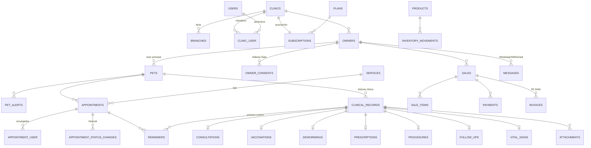

# Diseño de base de datos — Zooetia

> **Estado:** propuesta v1 (2026-09-30). Es la fuente de verdad del modelo; `info.md` §8 solo lo resume.
> Motor: **PostgreSQL 14+** (el servidor actual es 14.24). Basado en el brief (`info.md`) y en el benchmark de OkVet (`docs/benchmark-okvet.md`).
> Convención: tablas y columnas en inglés, `snake_case`, plural. Los textos de negocio están en español en la UI, no en el esquema.

---

## 0. Decisiones transversales

Estas reglas aplican a **todas** las tablas. Cada una lleva su porqué, porque cambiarlas después obliga a migrar datos.

| # | Decisión | Por qué |
|---|---|---|
| D1 | **Llaves primarias UUIDv7** (columna nativa `uuid` de Postgres, `HasUuids` en Laravel). | Los IDs viajan en URLs, en links de reserva y en WhatsApp. Un ID secuencial deja adivinar volúmenes y registros ajenos (en OkVet "ID 27561" revela el conteo). UUIDv7 es ordenable por tiempo, así que los índices no se fragmentan como con UUIDv4. Ocupa 16 bytes contra 8, un costo aceptable. |
| D2 | **Toda tabla de negocio lleva `clinic_id uuid not null`**, sin excepciones (incluidas las tablas hijas y pivote). Solo la omiten las de plataforma: `plans`, `users`, `tutor_accounts`, `tutor_login_codes`, `whatsapp_conversations` y las de sistema de Laravel. Los catálogos (D9) y `messages` la tienen *nullable*. | Un global scope simple (`where clinic_id = ?`) funciona igual en todos los modelos, sin joins. Así se puede escribir **un test que recorra el esquema** y falle si una tabla nueva no tiene `clinic_id`. |
| D3 | **Llaves foráneas compuestas `(clinic_id, x_id)`** en las relaciones de negocio: el padre tiene `unique (clinic_id, id)` y el hijo referencia ambas columnas. | Es defensa en profundidad: aunque falle la validación en PHP, **la base de datos rechaza** una cita que apunte a la mascota de otra clínica. Cuesta un índice único extra por tabla padre. |
| D4 | **Fechas y horas en `timestamptz` (UTC)**; las fechas sin hora (nacimiento, vencimiento) en `date`. La zona de negocio es `America/Bogota`, en `clinics.timezone`. | Es lo que pide el brief. `timestamptz` evita ambigüedades si algún día hay clínicas fuera de Colombia. |
| D5 | **Enums como `varchar` + `CHECK`**, mapeados a *backed enums* de PHP. **No** se usan `ENUM` de Postgres. | Agregar un valor a un `ENUM` de Postgres es incómodo en migraciones; un `CHECK` se reemplaza en una sola migración. |
| D6 | **Unidades normalizadas:** peso en **kg** (`numeric(7,3)`), temperatura en **°C** (`numeric(4,1)`). La conversión se hace en la UI. | OkVet guarda un valor con su unidad por separado, y eso complica las gráficas y los reportes ("peso en el tiempo"). Nosotros guardamos una sola unidad. |
| D7 | **Dinero en `numeric(14,2)`**, en COP. | La DIAN maneja 2 decimales; `float` nunca sirve para dinero. |
| D8 | **La historia clínica no se borra.** Los registros clínicos se **anulan** (`voided_at`, con motivo y autor) y se **bloquean** tras la ventana de edición (`locked_at`). Tutores y mascotas usan *soft delete* (`deleted_at`). | Es un registro médico con valor legal. Anular deja la traza de qué pasó; borrar la destruye. |
| D9 | **Catálogos mixtos:** una sola tabla con `clinic_id` *nullable*. `null` = global (sembrado por nosotros, de solo lectura); con valor = propio de la clínica. | La clínica ve las razas globales más las que agregó ella, con un solo modelo. Es la única excepción a D2, y usa su propio scope: `clinic_id = ? OR clinic_id IS NULL`. |
| D10 | **Auditoría** con `spatie/laravel-activitylog` (tabla `activity_log`, a la que se le agrega `clinic_id`) en modelos clínicos, tutores, mascotas, citas, ventas y permisos. | Hay que saber quién cambió qué y cuándo, sobre todo después de la ventana de edición. |
| D11 | **Snapshots en los documentos:** ventas, facturas y fórmulas copian nombre, precio y datos del cliente en el momento de emitirse. | Si mañana cambia el precio del producto o el nombre del tutor, la factura de ayer no debe cambiar. |
| D12 | **Búsqueda con `pg_trgm`:** índices trigram en nombres de tutores y mascotas. | La búsqueda "caro rest" → "Carolina Restrepo" debe ser rápida y tolerar errores de escritura. |

Convenciones de columnas: `created_at`, `updated_at` en todas. `created_by` / `updated_by` (FK `users`) donde importa la autoría. `deleted_at` solo donde se indica.

---

## 1. Mapa general (entidades principales)

---

## 2. Plataforma (globales, **sin** `clinic_id`)

### `plans`
Planes comerciales (Básico, Pro, Pro + Facturación).
| Columna | Tipo | Notas |
|---|---|---|
| id | uuid PK | |
| code | varchar(40) unique | `basic`, `pro`, `pro_invoicing` |
| name | varchar(80) | |
| price_monthly / price_yearly | numeric(14,2) | COP |
| features | jsonb | flags: `{"whatsapp_bot":true,"online_booking":true,"invoicing":false}` |
| limits | jsonb | `{"users":null,"branches":1,"whatsapp_msgs":500,"dian_docs":0}` (`null` = ilimitado) |
| is_active | boolean | |

### `subscriptions`
Estado comercial de la clínica. **La prueba gratis vive aquí.**
| Columna | Tipo | Notas |
|---|---|---|
| id | uuid PK | |
| clinic_id | uuid FK `clinics` | unique mientras esté vigente (se permite historial) |
| plan_id | uuid FK `plans` | durante la prueba: el plan Pro |
| status | varchar | `trialing`, `active`, `past_due`, `canceled`, `expired` |
| trial_ends_at | timestamptz null | |
| current_period_start / current_period_end | timestamptz | |
| canceled_at | timestamptz null | |
| billing_provider / billing_reference | varchar null | pasarela de cobro a la clínica (**[PENDIENTE]**: Wompi, ePayco…) |

Regla: al vencer `trial_ends_at` sin pago → `expired` → **solo lectura** (middleware que bloquea escrituras).

### Sistema de Laravel
`users` (ver §3), `password_reset_tokens`, `sessions`, `cache`, `cache_locks`, `jobs`, `job_batches`, `failed_jobs`, `personal_access_tokens` (**+ columna `clinic_id`**, ver D-auth en §3), `notifications`, `activity_log` (+ `clinic_id`).

---

## 3. Clínica, sedes, usuarios y permisos

### `clinics`
| Columna | Tipo | Notas |
|---|---|---|
| id | uuid PK | |
| name | varchar(150) | nombre comercial |
| slug | varchar(80) unique | link público de reserva: `zooetia.co/reservar/{slug}` |
| email / phone | varchar | contacto |
| logo_path | varchar null | |
| timezone | varchar(40) | default `America/Bogota` |
| currency | char(3) | default `COP` |
| status | varchar | `active`, `suspended` (no pago) |
| settings | jsonb | configuración chica y flexible (ver abajo) |
| created_at / updated_at | | |

`settings` (validado con un DTO en PHP): `edit_window_hours` (p. ej. 24), `prevent_overlaps` (bool), `default_appointment_minutes`, `week_starts_on`, `online_booking` `{enabled, min_notice_hours, max_days_ahead, requires_confirmation}`.
Criterio: lo que se **consulta o filtra** va en columnas o tablas; lo que solo se **lee con la clínica** va en `settings`.

**Implementado en la Fase 3 (2026-10-02):**
- Columnas `legal_name`, `tax_id` (NIT con dígito de verificación, `901234567-8`), `address` y `website`: identidad para el membrete de los PDF. No reemplazan a `clinic_fiscal_profiles`, que se llenará al activar la facturación electrónica (Fase 5) con los códigos DIAN completos.
- `logo_path`: PNG re-codificado (≤ 600 px, con transparencia) en el disco privado (`clinics/{id}/logo/`). La API lo expone como `logo_url` (`clinic/logo?v=hash`), nunca como ruta del disco.
- De `settings`, la clínica puede editar desde Configuración solo `edit_window_hours` (12, 24, 48 o 72), `prevent_overlaps` y `default_appointment_minutes`; el resto se mantiene y se fusiona, no se reemplaza.
- `pets.photo_path`: foto re-codificada a WebP (≤ 800 px, sin EXIF) en `clinics/{clinic_id}/pets/{pet_id}/`; la API la expone como `photo_url`.

### `clinic_fiscal_profiles` (1:1, solo si usa FE · Fase 5b, sin construir)
`clinic_id` (unique), `person_type` (`natural`/`juridica`), `id_type` (código DIAN), `nit`, `dv`, `legal_name`, `tax_regime`, `fiscal_responsibilities` jsonb (códigos DIAN), `address`, `municipality_code` (DIVIPOLA), `invoicing_provider` (`factus`, `alegra`), `provider_credentials` (**text cifrado** con el cast `encrypted` de Laravel), `is_enabled`.

### `invoice_numbering_ranges` (Fase 5b, sin construir)
Resoluciones de facturación DIAN: `clinic_id`, `document_type` (`invoice`, `credit_note`), `prefix`, `range_from`, `range_to`, `next_number`, `resolution_number`, `valid_from`, `valid_to`, `technical_key` (cifrado), `is_active`.

### `branches` (sedes; multi-sede real)
| Columna | Tipo | Notas |
|---|---|---|
| id | uuid PK | unique `(clinic_id, id)` (D3) |
| clinic_id | uuid FK | |
| name | varchar(120) | |
| address | varchar null | |
| municipality_code | varchar(10) null | DIVIPOLA |
| phone | varchar null | |
| latitude / longitude | numeric(9,6) null | para el mapa de la reserva online |
| is_active | boolean | |

Toda clínica nace con **una sede** creada automáticamente, así el resto del modelo siempre tiene `branch_id` y no hay casos especiales.

### `users` (global: una persona, varias clínicas)
| Columna | Tipo | Notas |
|---|---|---|
| id | uuid PK | |
| name | varchar(150) | |
| email | varchar unique | login |
| password | varchar | |
| phone | varchar null | |
| document_type / document_number | varchar null | |
| professional_license | varchar null | tarjeta profesional del veterinario (aparece en fórmulas y en la HC) |
| signature_path | varchar null | firma escaneada para PDFs |
| is_platform_admin | boolean | soporte interno de Zooetia; **nunca** se usa dentro de un tenant |
| last_login_at | timestamptz null | |

**Sin `clinic_id`**: es una de las excepciones a D2, porque un veterinario puede trabajar en varias clínicas. La pertenencia vive en `clinic_user`.

### `clinic_user` (membresía)
`clinic_id`, `user_id`, `status` (`invited`, `active`, `disabled`), `shows_in_agenda` (bool), `agenda_color` (varchar(7)), `joined_at`. `unique (clinic_id, user_id)`.

### `branch_user`
`clinic_id`, `branch_id`, `user_id`. `unique (branch_id, user_id)`. Limita en qué sedes trabaja o qué sedes ve cada usuario.

### `invitations`
`clinic_id`, `email`, `role`, `token_hash`, `invited_by`, `expires_at`, `accepted_at`.

### Notas de implementación (Fase 1, 2026-09-30)
- `roles`, `permissions` y `activity_log` conservan IDs **bigint**: son internos de los paquetes de Spatie y nunca viajan en URLs. `activity_log` guarda `subject_id`/`causer_id` como texto, porque apunta tanto a modelos UUID como a roles bigint.
- `invitations` tiene además `branch_ids` jsonb (sedes a asignar al aceptar; `null` = todas) y `revoked_at`.
- `personal_access_tokens.clinic_id` es *nullable* solo para el token corto de "elige una clínica" (10 min, habilidad `select-clinic`). Los tokens de clínica duran 30 días.
- `branch_user` tiene una FK compuesta a `clinic_user (clinic_id, user_id)`: la base de datos impide asignar a una sede a alguien que no es miembro de esa clínica.
- `subscriptions` tiene un índice único parcial: una sola suscripción vigente por clínica.

- **Fase 2b:** `owners.name_search` y `pets.name_search` guardan el nombre en minúsculas y sin tildes (lo mantiene el modelo), con índice GIN `pg_trgm`. La búsqueda combina palabras en cualquier orden (`ILIKE`), tolerancia a errores (`<%`, *word similarity*), documento, celular, nombre de mascota y microchip.
- Los celulares se guardan en E.164 (`+573157482096`); Colombia es el país por defecto al normalizar.

- **Fase 2c (agenda):** `schedules.weekday` usa ISO-8601 (1 = lunes … 7 = domingo). `schedules`, `schedule_blocks` y `appointment_user` tienen FK compuesta a `clinic_user`: solo miembros de la clínica tienen horario o citas. Los cruces de horario se evitan con un *advisory lock* de PostgreSQL por profesional (`pg_advisory_xact_lock`) mientras se valida, para que dos recepcionistas no reserven el mismo espacio al mismo tiempo. Estados y transiciones en `App\Enums\AppointmentStatus`; "Facturado" no es un estado.
- **Fechas:** todos los modelos usan `StoresDatesInUtc`. Eloquent guardaba una fecha en hora de Bogotá como si fuera UTC (5 h de diferencia); el trait la convierte antes de guardar. Las API reciben horas sin zona como hora de la clínica y responden en la zona de la clínica (`-05:00`).

- **Fase 2d (historia clínica):** cada tipo de registro es una clase en `app/Clinical/Types` (reglas, guardado, presentación y resumen), registrada en `RecordTypes`. Los hallazgos "no evaluado" no se guardan. `vaccinations.product_id` (inventario) se agregará en la Fase 4. Reglas de edición en `RecordAccess`: el autor edita y anula dentro de la ventana (24 h); después, solo quien tenga `clinical_records.edit_locked` / `clinical_records.void` (admin). El bloqueo se calcula al leer y el comando horario `clinical-records:lock` lo persiste. Los adjuntos se pueden agregar después del bloqueo (resultados de laboratorio), nunca a registros anulados; se guardan en `clinics/{clinic_id}/clinical-records/{id}/` de un disco privado (`ATTACHMENTS_DISK`). `morphMap`: `clinical_record`, `pet`, `owner`, `appointment`.

### Roles y permisos: Spatie con **teams**
Se usa la función de *teams* de `spatie/laravel-permission`, con `team_foreign_key = clinic_id`. Así **un mismo usuario puede ser admin en la clínica A y veterinario en la B**. Tablas: `roles` (con `clinic_id`, *nullable* para las plantillas globales), `permissions`, `model_has_roles` (con `clinic_id`), `model_has_permissions`, `role_has_permissions`.
Roles base: `admin`, `veterinarian`, `receptionist`. Los permisos son finos (`clinical_records.create`, `sales.void`, `settings.manage`…), así la clínica puede ajustarlos sin tocar código.

**D-auth, token ligado a la clínica:** al iniciar sesión, el usuario elige la clínica y el token de Sanctum guarda `clinic_id` (columna agregada a `personal_access_tokens`). Todas las peticiones con ese token operan en esa clínica. Cambiar de clínica implica emitir otro token. Así evitamos confiar en un header que el cliente puede manipular.

### Salvaguardas multi-clínica (decidido 2026-09-30: sí, "con mucho cuidado")
Un usuario en varias clínicas es el caso donde más fácil se filtran datos entre clínicas. Estas son las reglas obligatorias, y cada una lleva su test:

1. **Un token = una clínica.** El `clinic_id` sale **solo** del token, nunca de la URL, del body ni de un header.
2. **La membresía se verifica en cada petición:** el middleware exige que exista un `clinic_user` **activo** para (usuario, clínica del token). Si la clínica desactiva al usuario, sus tokens de esa clínica **dejan de funcionar en la siguiente petición**, y además se revocan.
3. **Falla cerrada:** si un modelo con `BelongsToClinic` se consulta **sin** una clínica en contexto, se lanza una excepción; **nunca** devuelve registros de todas las clínicas. Las tareas de plataforma usan un bypass explícito y auditado.
4. **Roles por clínica (Spatie teams):** el `team_id` se fija desde el token en cada petición. Ser admin en A no da ningún permiso en B. La caché de permisos se separa por clínica.
5. **Jobs en cola:** cada job lleva su `clinic_id` y un middleware de job fija y **limpia** el contexto antes y después, para que un worker nunca herede la clínica del job anterior.
6. **Privacidad del usuario:** una clínica **no ve** en qué otras clínicas trabaja su personal. Solo el propio usuario cambia su email y contraseña; la clínica solo gestiona la membresía y el rol.
7. **Unirse a otra clínica** solo por **invitación aceptada** por el usuario, nunca por asignación directa.
8. **Auditoría:** cada acción queda en `activity_log` con `user_id` **y** `clinic_id`.

Tests dedicados: el mismo usuario en las clínicas A y B, con su token de A, **no lee ni escribe nada de B**, ni por ID directo, ni por relaciones, ni por búsqueda, ni por jobs.

---

## 4. Tutores y mascotas

### `owners` (tutores) — *soft delete*
| Columna | Tipo | Notas |
|---|---|---|
| id | uuid PK | unique `(clinic_id, id)` |
| clinic_id | uuid FK | |
| document_type | varchar(10) null | `CC`, `CE`, `NIT`, `PAS`, `TI`, `PPT`, `NUIP`, `DIE` |
| document_number | varchar(20) null | |
| full_name | varchar(150) | nombre o razón social |
| email | varchar null | "no tiene" = `null` |
| mobile_phone | varchar(20) null | **E.164** (`+573157482096`), llave para WhatsApp |
| phone | varchar(20) null | fijo |
| address | varchar null | |
| municipality_code | varchar(10) null | DIVIPOLA (Bucaramanga = 68001) |
| neighborhood | varchar(80) null | barrio/localidad |
| alt_contact_name / alt_contact_phone | varchar null | contacto autorizado |
| referral_source | varchar(30) null | cómo nos encontró: `instagram`, `google`, `referido`… |
| important_notes | text null | se muestra como alerta al abrir la ficha |
| created_by | uuid FK users | |
| deleted_at | timestamptz null | |

Índices:
- `unique (clinic_id, document_type, document_number) WHERE document_number IS NOT NULL AND deleted_at IS NULL`
- `(clinic_id, mobile_phone)`: el bot de WhatsApp busca por número.
- GIN trigram en `full_name`.

**Aislados por clínica:** si la misma persona lleva su perro a dos clínicas Zooetia, existen dos registros. Es deliberado, por privacidad (a diferencia de OkVet).

### `owner_consents` (Habeas Data, Ley 1581) — *append-only*
| Columna | Tipo | Notas |
|---|---|---|
| id | uuid PK | |
| clinic_id, owner_id | uuid FK | |
| type | varchar | `data_processing`, `channel_whatsapp`, `channel_sms`, `channel_email`, `marketing` |
| granted | boolean | `true` = otorga, `false` = revoca |
| policy_version | varchar(20) null | versión de la política aceptada |
| source | varchar | `in_person`, `online_booking`, `whatsapp`, `owner_portal`, `imported` |
| recorded_by | uuid FK users null | `null` si lo hizo el propio tutor (reserva online / WhatsApp) |
| evidence | jsonb null | IP, user agent, mensaje de WhatsApp de aceptación |
| created_at | timestamptz | = momento del consentimiento |

El estado actual es **el último registro por `type`**. Nunca se actualiza ni se borra: revocar es insertar `granted=false`. **El envío de cualquier mensaje verifica el consentimiento del canal** (en `reminders`, `status = skipped_no_consent`).

### `pets` (mascotas) — *soft delete*
| Columna | Tipo | Notas |
|---|---|---|
| id | uuid PK | unique `(clinic_id, id)` |
| clinic_id | uuid FK | |
| owner_id | uuid | FK compuesta → `owners` (tutor principal) |
| name | varchar(80) | |
| species_id | uuid FK `species` | |
| breed_id | uuid FK `breeds` null | |
| breed_other | varchar(80) null | si no está en el catálogo |
| sex | varchar | `male`, `female`, `unknown` |
| birth_date | date null | |
| birth_date_is_estimated | boolean | muy común ("tiene como 3 años") |
| color | varchar(60) null | texto; la UI sugiere valores ya usados |
| size | varchar null | `toy`, `small`, `medium`, `large`, `giant` |
| reproductive_status | varchar | `intact`, `neutered`, `unknown` |
| temperament | varchar null | `very_docile`, `docile`, `reserved`, `reactive`, `aggressive` |
| diet | varchar(120) null | alimento ("Pro Plan Adulto") |
| microchip | varchar(30) null | |
| weight_kg | numeric(7,3) null | **caché** del último peso (el histórico está en `vital_signs`) |
| photo_path | varchar null | |
| is_service_animal / is_emotional_support | boolean | |
| deceased_at | date null | fallecido (bloquea recordatorios) |
| deceased_reason | varchar null | |
| important_notes | text null | |
| public_token | varchar(32) unique | QR del carnet (§10b) |
| public_profile_enabled | boolean | página pública del QR activa |
| lost_mode_enabled_at | timestamptz null | modo "mascota perdida" |
| public_contact_phone | varchar null | contacto que se muestra en modo perdida |
| deleted_at | timestamptz null | |

Índices: `(clinic_id, owner_id)`, `unique (clinic_id, microchip) WHERE microchip IS NOT NULL`, GIN trigram en `name`.

**Un solo tutor principal** (como OkVet) + contacto autorizado. Si luego se necesitan co-tutores, se agrega una tabla `owner_pet` sin romper nada. Cambiar de dueño = actualizar `owner_id` (queda en la auditoría).

### `pet_alerts` (alertas clínicas visibles siempre)
`clinic_id`, `pet_id`, `type` (`allergy`, `chronic_condition`, `infectious_disease`, `behavior`, `other`), `alert_catalog_id` (FK null → catálogo `clinical_alerts`: leishmaniosis, FIV…), `description`, `severity` (`low`, `medium`, `high`), `is_active`, `created_by`.
Mejora sobre OkVet: incluye **alergias** (a medicamentos, por ejemplo), no solo enfermedades infecciosas.

### `pet_lifestyles` (1:1, opcional)
Los "datos generales" de OkVet: `pet_id` (unique), `clinic_id`, `housing`, `food_amount`, `feeding_frequency`, `bath_frequency`, `other_pets`, `last_heat_date`, `notes`.

---

## 5. Catálogos (mixtos: `clinic_id` null = global, D9)

| Tabla | Columnas principales | Semilla inicial |
|---|---|---|
| `species` | `code`, `name`, `sort` | canino, felino, equino, bovino, ave, conejo, roedor, reptil, porcino, otro |
| `breeds` | `species_id`, `name` | razas caninas y felinas más comunes en Colombia + "Criollo" |
| `vaccines` | `name`, `manufacturer`, `species_ids` jsonb, `protects_against`, `default_booster_days` | Nobivac, Vanguard, Feligen, rabia… |
| `procedure_types` | `name`, `category` (`surgery`, `procedure`, `diagnostic`) | esterilización, profilaxis dental, curaciones… |
| `clinical_alerts` | `name`, `species_ids` jsonb, `type` | leishmaniosis, ehrlichiosis, FIV, FeLV, PIF… |
| `medications` *(post-MVP)* | `name`, `active_ingredient`, `presentation` | vademécum básico |

Unique: `(coalesce(clinic_id, '00000000-0000-0000-0000-000000000000'), species_id, lower(name))` en `breeds` (y equivalentes), para no duplicar una raza global dentro de la clínica.

### `services` (servicios de la clínica: agenda + ventas)
`clinic_id`, `name`, `category` (`consultation`, `vaccination`, `deworming`, `grooming`, `surgery`, `lab`, `imaging`, `hospitalization`, `other`), `duration_minutes`, `price` numeric(14,2), `tax_rate` numeric(5,2), `is_bookable_online`, `color`, `is_active`.
Reemplaza el "tipo + subtipo" de OkVet: la cita apunta a un servicio, que ya trae duración y precio para la venta.

---

## 6. Agenda y reserva online

### `schedules` (horario regular)
`clinic_id`, `branch_id`, `user_id` (null = horario de la sede), `weekday` (0–6), `start_time` time, `end_time` time. Permite varias franjas por día (mañana y tarde).

### `schedule_blocks` (excepciones)
`clinic_id`, `branch_id` null, `user_id` null, `starts_at`, `ends_at`, `reason` (festivo, vacaciones, capacitación). Si `branch_id` y `user_id` son `null`, aplica a toda la clínica.

### `appointments` (citas)
| Columna | Tipo | Notas |
|---|---|---|
| id | uuid PK | unique `(clinic_id, id)` |
| clinic_id, branch_id | uuid FK | |
| owner_id | uuid null | FK compuesta; `null` solo si es un bloqueo de espacio |
| pet_id | uuid null | FK compuesta; puede faltar en una reserva online de un paciente nuevo |
| service_id | uuid FK null | |
| starts_at / ends_at | timestamptz | `CHECK (ends_at > starts_at)` |
| is_time_unset | boolean | "sin hora definida" (atención por orden de llegada) |
| is_home_visit | boolean | |
| home_address | varchar null | |
| status | varchar | ver estados |
| source | varchar | `staff`, `online_booking`, `whatsapp` |
| notes_for_owner | text null | visible para el tutor |
| internal_notes | text null | |
| cancellation_reason | varchar null | |
| created_by | uuid FK users null | `null` si la creó el tutor |
| deleted_at | timestamptz null | solo para citas creadas por error; lo normal es `cancelled` |
| booking_details | jsonb null | reserva en línea: datos que dio la persona (nombre, documento, celular, mascota, autorizaciones) hasta que la clínica acepta ([`reservas.md`](reservas.md)) |

**Estados:** `requested` (solicitud en línea que aparta la hora, sin aceptar) → `scheduled` → `confirmed` → `checked_in` → `in_progress` → `completed`, con salidas a `cancelled` y `no_show`. Las transiciones válidas viven en una clase `AppointmentStatus` (máquina de estados en PHP).

Índices: `(clinic_id, starts_at)`, `(clinic_id, branch_id, starts_at)`, `(clinic_id, pet_id, starts_at)`, `(clinic_id, status, starts_at)` (para recordatorios y confirmaciones pendientes).

### `appointment_user` (encargados, N:M)
`clinic_id`, `appointment_id`, `user_id`, `role` (`primary`, `assistant`). `unique (appointment_id, user_id)`.
**Solapamientos:** si `prevent_overlaps` está activo, se validan en PHP dentro de una transacción con `SELECT … FOR UPDATE` sobre las citas del usuario en ese rango. (Una *exclusion constraint* de Postgres obligaría a duplicar las horas en esta tabla; por ahora no vale la pena.)

### `appointment_status_changes` (historial) — *append-only*
`clinic_id`, `appointment_id`, `from_status`, `to_status`, `changed_by` (user null), `channel` (`staff`, `whatsapp`, `online`, `system`), `note`, `created_at`.
Base del bot: "Confirmada por WhatsApp el 29/09 a las 18:02" y la métrica de tasa de confirmación y de inasistencia.

---

## 7. Historia clínica

### Diseño: tabla padre + tablas de detalle (*class table inheritance*)

Todos los registros clínicos comparten lo mismo: mascota, fecha, autor, sede, cita, próximo control, bloqueo, anulación y adjuntos. Por eso hay **una tabla padre `clinical_records`**, y cada tipo tiene su tabla de detalle 1:1, que usa **el mismo id**.

Por qué, frente a una tabla independiente por tipo:
- **Línea de tiempo** de la mascota = una sola consulta a `clinical_records`, ordenada por `occurred_at`, sin UNIONs.
- **Bloqueo, anulación, próximo control, adjuntos y recordatorios** se implementan **una vez**, no seis.
- Los contadores del menú ("Consultas 3, Vacunas 5") salen de un solo `GROUP BY type`.
- Agregar un tipo nuevo (hospitalización, spa) es crear una tabla de detalle, sin tocar lo común.

### `clinical_records` (padre)
| Columna | Tipo | Notas |
|---|---|---|
| id | uuid PK | unique `(clinic_id, id)` |
| clinic_id, branch_id | uuid FK | |
| pet_id | uuid | FK compuesta → `pets` |
| type | varchar | `consultation`, `vaccination`, `deworming`, `prescription`, `procedure`, `follow_up`, `note` (post-MVP: `hospitalization`, `lab_order`, `imaging`, `grooming`…) |
| occurred_at | timestamptz | fecha clínica (puede diferir de `created_at`) |
| author_id | uuid FK users | profesional responsable |
| appointment_id | uuid null | FK compuesta → cita que originó el registro |
| parent_record_id | uuid null | FK a `clinical_records` (p. ej. fórmula o vacuna aplicada **dentro** de una consulta) |
| next_control_at | date null | genera un recordatorio (§10) |
| next_control_note | varchar null | "Refuerzo de rabia" |
| locked_at | timestamptz null | lo fija un job al vencer `settings.edit_window_hours` |
| voided_at / voided_by / void_reason | | anulación (D8) |
| ai_assisted | boolean default false | el texto fue generado o corregido con IA y aceptado por el autor (trazabilidad médico-legal) |
| visible_to_owner | boolean | lo ve el tutor en su portal (default según el tipo, §10b) |
| created_at / updated_at | | |

Índices: `(clinic_id, pet_id, occurred_at desc)` (línea de tiempo), `(clinic_id, type, occurred_at)`, `(clinic_id, next_control_at) WHERE next_control_at IS NOT NULL AND voided_at IS NULL`.

**Regla de edición:** si `locked_at` no es `null`, solo un rol con `clinical_records.edit_locked` puede modificar, y siempre queda en `activity_log`.

### Detalles (PK = FK a `clinical_records.id`, + `clinic_id`)

**`consultations`** (formato SOIP)
`reason` (varchar), `subjective` (anamnesis), `objective` (hallazgos del examen), `assessment` (interpretación / diagnóstico), `plan_treatment`, `plan_diagnostic`: todos `text`.

**`consultation_diagnoses`** (N por consulta)
`clinic_id`, `clinical_record_id`, `kind` (`presumptive`, `differential`, `definitive`), `description`, `code` null (a futuro, codificación estándar como VeNom para reportes de "diagnósticos más frecuentes").

**`vital_signs`** (1:1 con consulta o seguimiento)
`weight_kg`, `temperature_c`, `heart_rate` (lpm), `respiratory_rate` (rpm), `capillary_refill_s`, `spo2_pct`, `systolic_bp`, `diastolic_bp`, `glucose_mg_dl`, `body_condition_score` (1–9), `mucous_membranes` (`pink`, `pale`, `cyanotic`, `icteric`, `hyperemic`), `hydration` (`normal`, `mild`, `moderate`, `severe`), `pain_score` (0–10), `notes`. Todas nullable.
Al guardar un peso, se actualiza `pets.weight_kg`.

**`physical_exam_findings`** (N por consulta)
`clinic_id`, `clinical_record_id`, `system` (`attitude`, `hydration`, `nutrition`, `lymph_nodes`, `mucous_membranes`, `cardiovascular`, `respiratory`, `digestive`, `urinary`, `reproductive`, `musculoskeletal`, `nervous`, `skin`, `eyes`, `ears`), `status` (`not_evaluated`, `normal`, `abnormal`), `notes`. `unique (clinical_record_id, system)`.
Solo se guardan los sistemas evaluados: los "No evaluado" no ocupan filas.

**`vaccinations`**
`vaccine_id` (FK catálogo, null), `vaccine_name` (snapshot), `manufacturer`, `lot_number`, `lot_expires_on` date, `dose_number`, `route`, `product_id` (FK inventario, null: si se indica, descuenta stock).
La próxima dosis está en `clinical_records.next_control_at`.

**`dewormings`**
`kind` (`internal`, `external`, `both`), `product_name`, `product_id` null, `dose`.

**`prescriptions`** + **`prescription_items`**
Encabezado: `diagnosis`, `instructions`. Ítems: `clinic_id`, `clinical_record_id`, `medication` (texto; `medication_id` post-MVP), `presentation`, `dose`, `frequency`, `duration`, `route`, `quantity`, `notes`, `sort`.
Genera un PDF con `users.professional_license` y la firma.

**`procedures`** (cirugías y procedimientos)
`procedure_type_id` null, `name` (snapshot o libre), `description`, `premedication`, `anesthesia`, `complications`, `outcome`.

**`follow_ups`** (seguimientos)
`kind` (`phone_call`, `in_person`, `post_op`, `other`), `reason`, `details`. Puede tener `vital_signs`.

**`clinical_notes`**: `body`. Nota libre, para lo que no encaja en otro tipo.

### `attachments` (polimórfico)
`clinic_id`, `attachable_type`, `attachable_id` (normalmente `clinical_records`; también `owners` y `pets`), `disk`, `path`, `original_name`, `mime_type`, `size_bytes` bigint, `category` (`image`, `lab_result`, `imaging`, `document`, `other`), `visible_to_owner` (bool, default false), `uploaded_by`.
Índice `(attachable_type, attachable_id)`. La ruta en disco incluye el `clinic_id`: `clinics/{clinic_id}/…`.

---

## 8. Operación: tareas, inventario, ventas (registro simple)

### `tasks`
`clinic_id`, `title`, `description`, `owner_id` null, `pet_id` null, `assignee_id` (user), `created_by`, `due_at` null, `status` (`pending`, `done`, `discarded`), `completed_at`, `source_type` / `source_id` (morph: cita o registro que la originó).

> Inventario y ventas como quedaron construidos en la Fase 5a (2026-10-05). Reglas de negocio en [`inventario.md`](inventario.md).

### `products`
`clinic_id`, `name`, `name_key` (nombre en minúsculas y sin diferencias de tildes, calculado en PHP: evita duplicados), `sku` null, `kind` (`product`, `medication`, `vaccine`, `supply`), `unit` (`unit`, `box`, `ml`, `tablet`, `dose`, `g`, `kg`, `bottle`, `pipette`), `sale_price` (IVA incluido), `cost_price` null, `tax_rate`, `tracks_stock` bool, `min_stock` numeric(12,3), `is_active`. Únicos: `(clinic_id, name_key)` y `(clinic_id, sku) WHERE sku IS NOT NULL`.

### `inventory_stocks` (existencia actual por sede)
`clinic_id`, `branch_id`, `product_id`, `quantity` numeric(12,3) (puede quedar negativa para no frenar la atención). `unique (branch_id, product_id)`. Que exista la fila significa que la sede **maneja** el producto (solo esas sedes generan alertas). Se actualiza en la misma transacción que el movimiento, con la fila bloqueada.

### `inventory_movements` — *append-only*
`clinic_id`, `branch_id`, `product_id`, `type` (`initial`, `purchase`, `adjustment`, `transfer_out`, `transfer_in`, `sale`, `sale_void`, `clinical_use`), `quantity` (con signo, nunca 0), `balance_after` (existencia de la sede justo después), `unit_cost` null, `lot_number` null, `expires_on` null, `reason` null (ajustes: `count`, `damage`, `loss`, `expired`, `other`), `note`, `transfer_group` null (une la salida y la entrada de un traslado), `reference_type` / `reference_id` (venta, registro clínico), `user_id`, `occurred_at`, `lot_closed_at` null (lote agotado o retirado: deja de alertar por vencimiento), `created_at`.
El stock se puede recalcular desde aquí si algún día `inventory_stocks` se desincroniza.

### `sales` (registro de ingresos; no es factura electrónica)
| Columna | Tipo | Notas |
|---|---|---|
| id | uuid PK | unique `(clinic_id, id)` |
| clinic_id, branch_id | uuid FK | |
| number | integer | consecutivo **por clínica**: `unique (clinic_id, number)` |
| owner_id | uuid null | FK compuesta (venta de mostrador = null) |
| status | varchar | `open`, `partially_paid`, `paid`, `void` |
| subtotal / discount_total / tax_total / total / paid_total | numeric(14,2) | `tax_total` = IVA **incluido** en el total |
| customer_snapshot | jsonb null | nombre, documento y celular al momento de vender (D11) |
| notes | varchar null | |
| sold_by | uuid FK users | |
| sold_at / paid_at | timestamptz | |
| voided_at / voided_by / void_reason | | anular es la única forma de "borrar" |

### `sale_items`
`clinic_id`, `sale_id` (cascade), `item_type` (`product`, `service`, `custom`), `product_id` null, `service_id` null, `description` (snapshot), `quantity`, `unit_price`, `discount` (valor descontado en la línea), `tax_rate`, `tax_amount` (IVA dentro del total), `total`, `appointment_id` null (cobro desde la cita), `clinical_record_id` null (producto usado en la historia clínica), `created_by`.

### `payments`
`clinic_id`, `sale_id`, `method` (`cash`, `card`, `transfer`, `nequi`, `daviplata`, `other`), `amount` (> 0), `reference`, `received_by`, `paid_at`, `voided_at` / `voided_by` / `void_reason`.

**Reportes y exportación** para el contador (CSV de ventas por ítem y de pagos): consultas sobre `sales` + `sale_items` + `payments` en `App\Sales\SalesReports`.

---

## 9. Facturación electrónica DIAN (Fase 5b: diseño, todavía sin construir)

### `invoices`
| Columna | Tipo | Notas |
|---|---|---|
| id | uuid PK | |
| clinic_id | uuid FK | |
| sale_id | uuid | FK compuesta |
| document_type | varchar | `invoice`, `credit_note` |
| related_invoice_id | uuid null | nota crédito → factura |
| provider | varchar | `factus`, `alegra` (detrás de `InvoicingProvider`) |
| status | varchar | `pending`, `sending`, `issued`, `rejected`, `failed` |
| prefix / number | varchar / bigint null | asignado desde `invoice_numbering_ranges` |
| cufe | varchar(120) null | unique cuando no es null |
| issued_at | timestamptz null | |
| customer_snapshot | jsonb | datos fiscales del adquiriente (D11) |
| totals | jsonb | subtotal, impuestos, total |
| provider_document_id | varchar null | |
| pdf_path / xml_path | varchar null | |
| idempotency_key | uuid **unique** | el job reintenta sin duplicar facturas |
| attempts | smallint | |
| last_error | text null | |
| request_payload / response_payload | jsonb null | auditoría del intercambio con el proveedor |

---

## 10. Mensajería, recordatorios y WhatsApp

### `whatsapp_accounts`
`clinic_id` (null = número compartido de la plataforma), `waba_id`, `phone_number_id` (unique), `display_phone`, `access_token` (cifrado), `status`.

**Decidido (2026-09-30): un número compartido de Zooetia para todas las clínicas.** Exigir que cada clínica tramite su propia cuenta de WhatsApp Business API sería una barrera de entrada. En el MVP habrá **una sola fila con `clinic_id = null`**; la columna se conserva por si más adelante se ofrece "número propio" como add-on.

Consecuencias de diseño:
- **Toda plantilla nombra a la clínica** ("Hola Carolina, te escribimos de *Clínica Anipet*…"). El perfil de WhatsApp muestra "Zooetia".
- **Enrutamiento de respuestas entrantes** (el mensaje llega al número común, sin clínica):
  1. Si el tutor responde *citando* un mensaje (`context.id` de Meta), la clínica es la de ese mensaje en `messages`.
  2. Si pulsa un **botón de respuesta rápida**, el payload del botón lleva `clinic_id` + `appointment_id` firmados.
  3. Si escribe texto libre, se usa la clínica del **último mensaje saliente** a ese número dentro de la ventana de 24 h.
  4. Si hay ambigüedad (el tutor tiene mascotas en dos clínicas Zooetia), el bot pregunta con una lista.
- **Reputación compartida:** si una clínica abusa y el número baja de calidad en Meta, afecta a todas. Por eso en el MVP solo se permiten **plantillas utility** (recordatorios y confirmaciones), sin marketing masivo, con tope de envíos por clínica (`usage_counters` + límites del plan).
- **Límite de mensajería de Meta:** un número nuevo arranca con un tope de conversaciones iniciadas por día que sube con el uso y la calidad. Hay que tenerlo en cuenta al sumar clínicas.

### `message_templates`
`clinic_id` null (null = plantilla global de Zooetia), `channel` (`whatsapp`, `sms`, `email`), `purpose` (`appointment_reminder`, `appointment_confirmation`, `next_control`, `vaccine_due`, `custom`), `provider_template_name` (nombre aprobado en Meta), `language` (`es_CO`), `category` (`utility`, `marketing`), `body`, `variables` jsonb, `status` (`draft`, `pending_approval`, `approved`, `rejected`).

### `reminder_rules` (configuración de la clínica)
`clinic_id`, `trigger` (`appointment`, `next_control`), `record_type` null (filtra por tipo de registro: vacunas, desparasitaciones…), `offset_minutes` (negativo = antes), `channel`, `template_id`, `is_active`.
Ejemplos: "24 h antes de cada cita por WhatsApp"; "7 días antes del próximo control de vacunas".

### `reminders` (instancias programadas)
`clinic_id`, `remindable_type` / `remindable_id` (`appointments` o `clinical_records`), `owner_id`, `rule_id` null (null = manual), `channel`, `template_id`, `scheduled_for` timestamptz, `status` (`pending`, `sent`, `failed`, `cancelled`, `skipped_no_consent`, `skipped_deceased`), `message_id` null, `attempts`.
Índice `(status, scheduled_for)`: el scheduler de Laravel toma los vencidos y encola los jobs.
Si la cita se cancela o reprograma, sus recordatorios `pending` se cancelan o recalculan.

**Implementado en la Fase 4c (2026-10-02):** `reminders` agrega `event_at` (la hora de la cita o el día del control al planear: si cambia, se planea uno nuevo y el enviado no se repite) y los estados `queued` / `sending` (dispatcher y envío sin duplicados). Los motivos de no envío son `skipped_no_consent`, `skipped_no_phone`, `skipped_deceased`, `skipped_answered`, `skipped_limit` y `skipped_plan`. El horario de envío y la anticipación mínima van en `clinics.settings.reminders`. Detalle de funcionamiento: [`whatsapp.md`](whatsapp.md).

### `messages` (bitácora única de envíos y recepciones) — *append-only salvo el estado*
| Columna | Tipo | Notas |
|---|---|---|
| id | uuid PK | |
| clinic_id | uuid FK **null** | `null` solo para entrantes aún no enrutados (número compartido); se completa al enrutar |
| owner_id | uuid null | |
| channel | varchar | `whatsapp`, `sms`, `email` |
| direction | varchar | `outbound`, `inbound` |
| to / from | varchar | |
| template_id | uuid null | |
| body | text null | texto renderizado |
| payload | jsonb null | request/webhook crudo |
| provider_message_id | varchar null | `wamid` de Meta: **unique**, para idempotencia de webhooks |
| status | varchar | `queued`, `sent`, `delivered`, `read`, `failed` |
| pricing_category | varchar null | `utility`, `marketing`, `service` (Meta, desde el 1-oct-2026 también cobra *service*) |
| cost_usd | numeric(10,5) null | costo reportado por Meta |
| error | text null | |
| related_type / related_id | morph null | cita, recordatorio, factura |
| sent_at / delivered_at / read_at | timestamptz null | |

### `whatsapp_conversations` (estado del bot) — tabla de **plataforma**
Con número compartido, la conversación pertenece al **teléfono**, no a una clínica: `phone` (E.164, **unique**), `active_clinic_id` null (clínica con la que se está hablando ahora), `owner_id` null, `state` (`idle`, `handoff_human`), `context` jsonb (p. ej. `{ack_at}`), `last_inbound_at` (ventana de 24 h de Meta), `needs_attention_since` null (texto libre que el bot pasó al equipo; alimenta la bandeja y su contador), `assigned_user_id` null.
Implementado en 4d (`2026_10_06_000002`). El bot **no guarda estado de conversación**: cada botón trae en su *payload* la acción y el id del mensaje (`slot:{id}:202610050800`), así que tocar un botón viejo funciona igual y no hay estados a medias.
Es una excepción a D2 (va en la lista blanca del test de esquema). Todo lo que el bot hace **dentro** de una clínica (confirmar, reprogramar) pasa por los modelos normales con `active_clinic_id` como tenant.

**Bot del MVP sin IA:** las plantillas llevan **botones de respuesta rápida** (Confirmar / Reprogramar / Cancelar). Así se cubre la mayor parte del flujo de confirmación sin gastar tokens. La IA para entender texto libre queda como mejora posterior (ver `info.md`).

### `usage_counters` (consumo por clínica y mes)
`clinic_id`, `period` (`2026-10`), `metric` (`whatsapp_utility`, `whatsapp_marketing`, `whatsapp_service`, `sms`, `email`, `dian_documents`, `ai_tokens`, `storage_bytes`), `quantity` bigint, `cost` numeric(14,4). `unique (clinic_id, period, metric)`.
Sirve para aplicar los límites del plan, cobrar excedentes y ver el margen real por clínica.

---

## 10c. Documentos y firmas (2026-10-03)

**`pet_documents`**: `clinic_id`, `pet_id`, `owner_id` (FK compuestas), `type` (código de `DocumentTypes`), `template_version`, `title`, `data` jsonb (campos del caso), `snapshot` jsonb (clínica, tutor, mascota, veterinario, firmantes y párrafos ya llenos: **congelado al crear**), `status` (`draft`, `signing`, `signed`, `voided`), `vet_id` (FK a `clinic_user`), `content_hash` (SHA-256 de lo firmado, se fija con la primera firma), `pdf_path` + `pdf_sha256` (PDF firmado, generado una vez), `signed_at`, `voided_at`/`voided_by`/`void_reason`, `created_by`.

**`pet_document_signatures`**: `pet_document_id`, `role` (`owner`, `vet`, `witness`; **unique por documento**), `signer_name`, `signer_document`, `signer_user_id` (el veterinario), `image_path` (PNG del trazo), `method` (`in_person`; `remote` en D3), `content_hash`, `ip`, `user_agent`, `collected_by`, `signed_at`.

**`pet_document_requests`** (firma a distancia, D3): `pet_document_id`, `role` (`owner`), `token_hash` (sha256, **unique**), `channel` (`whatsapp`, `email`, `link`), `expires_at` (48 h), `attempts` (máx. 5), `used_at`, `revoked_at`, `created_by`.

**`document_templates`** (D4): `clinic_id`, `type`, `body` jsonb (párrafos `{text|list, when?}`), `version` (sube en cada guardado), `base_version` (versión de Zooetia desde la que se editó), `updated_by`. `unique (clinic_id, type)`. Sin fila = texto de Zooetia.

Ojo: `jsonb` no conserva el orden de las llaves; el orden de los firmantes se fija en código. Detalle y evidencias: [`documentos.md`](documentos.md).

## 10b. Portal del tutor y carnet digital (decidido 2026-09-30, Fase 4)

Idea: el tutor entra a un perfil propio, ve los datos y el historial de vacunas de su mascota y descarga un **carnet/escarapela en PDF con QR**. Es un **portal web** dentro de la misma app Next.js, no una app móvil (la app para dueños sigue fuera de alcance en el brief). OkVet ya tiene algo parecido (su app OkPet), así que por sí solo no es diferenciador; **el carnet con QR verificable y el modo "mascota perdida" sí lo son.**

### Identidad del tutor (global, **sin** `clinic_id`)
Los `owners` son por clínica (privacidad). La persona que entra al portal es una **cuenta de plataforma** que se **vincula** a sus registros `owners` en cada clínica, **solo después de verificar su celular**.

> **Implementado en 4e (2026-10-02, migración `2026_10_07_000001`).** Cambió respecto al diseño inicial: el acceso es por **invitación de la clínica** (enlace de un solo uso) + correo y contraseña con sesión larga, **sin códigos por ingreso** (cada código por WhatsApp es un mensaje *authentication* que cobra Meta). Detalle y flujo en [`portal.md`](portal.md).

**`tutor_accounts`** (plataforma, sin `clinic_id`)
`id`, `name`, `email` (**unique**, login, en minúsculas), `phone` (E.164, **unique**: la identidad; se toma del tutor de la invitación, el usuario no lo escribe), `password`, `last_login_at`.

**`tutor_account_owner`** (vínculo cuenta ↔ tutor de cada clínica)
`clinic_id`, `tutor_account_id`, `owner_id` (FK compuesta), `link_method` (`invitation`), `linked_at`. `unique (clinic_id, owner_id)`. Solo se crea al aceptar una invitación (no hay vinculación automática por celular). Ver sus propios datos en cada clínica es además el **derecho de acceso** de la Ley 1581.

**`tutor_invitations`**
`clinic_id`, `owner_id`, `token_hash` (sha256, **unique**: el enlace nunca se guarda en claro), `expires_at` (7 días), `accepted_at`, `tutor_account_id`, `created_by`. Una invitación nueva reemplaza la pendiente del mismo tutor.

Tokens de Sanctum de `TutorAccount` con la habilidad `tutor` y **sin clínica** (180 días). Las rutas del personal exigen un token de clínica (`ResolveClinicFromToken`) y las del portal un token de tutor (`EnsureTutorToken`): **nunca se cruzan** (probado en `TutorPortalTest`).

**`tutor_login_codes`** (plataforma): `tutor_account_id`, `purpose` (`password_reset`), `channel` (`email`), `code_hash` (HMAC con la APP_KEY), `expires_at` (15 min), `attempts` (máx. 5), `consumed_at`. Solo vale el último código. Ver `portal.md`.

### Qué ve el tutor (control por la clínica)
- Columna nueva **`clinical_records.visible_to_owner`** (boolean). Por defecto, según el tipo: vacunaciones, desparasitaciones y fórmulas = `true`; consultas, procedimientos y notas = `false`. La clínica puede cambiar ese valor por defecto en `settings.owner_portal` y ajustarlo en cada registro.
- Columna nueva **`attachments.visible_to_owner`** (boolean, default `false`): para compartir, por ejemplo, un resultado de laboratorio.
- Siempre visible: datos de la mascota, foto, peso en el tiempo, próximas citas y próximos controles.

### Carnet digital con QR
Columnas nuevas en **`pets`**:
| Columna | Tipo | Notas |
|---|---|---|
| public_token | varchar(32) **unique** | token aleatorio del QR (no el UUID); se puede **regenerar** para invalidar carnets viejos |
| public_profile_enabled | boolean default true | el tutor puede apagar la página pública |
| lost_mode_enabled_at | timestamptz null | **modo "mascota perdida"**: la página pública muestra el contacto del tutor y un aviso |
| public_contact_phone | varchar null | teléfono a mostrar en modo perdida (puede no ser el principal) |

- **El QR apunta a** `zooetia.co/m/{public_token}`, una página pública con **datos mínimos**: foto, nombre, especie y raza, clínica, y **estado de vacunas verificado** (p. ej. "Antirrábica vigente hasta 14/05/2027 ✔ aplicada en Clínica Anipet"). **Nunca** muestra documento, dirección ni la historia clínica.
- Uso real: guarderías, peluquerías, hoteles caninos, conjuntos residenciales y viajes piden el carné de vacunación. Con el QR **lo verifican al instante** y no dependen de un papel que se pierde o se falsifica.
- **El PDF del carnet/escarapela se genera al vuelo** (no se guarda): foto, datos básicos, tabla de vacunas y QR. El formato de escarapela sirve para imprimir o plastificar.
- Accesos de la página pública en **`pet_public_views`** (`pet_id`, `clinic_id`, `viewed_at`, `ip_hash`, `user_agent`): útil en modo perdida ("tu mascota fue escaneada hace 10 min") y para detectar abuso. Con rate limit.

---

## 10d. Notificaciones del equipo (2026-10-03)

### `staff_notifications`
`clinic_id`, `user_id` (destinatario; cascade), `type` (p. ej. solicitud de cita nueva, cancelación por WhatsApp, alerta de inventario), `title`, `body` null, `url` null (adónde lleva el clic), `read_at` null, `created_at`. Índice `(clinic_id, user_id, created_at)`. La campana las consulta ([`notificaciones.md`](notificaciones.md)).

### Columnas agregadas a `users` (registro, 2026-10-03)
`terms_accepted_at`, `terms_version`: aceptación de términos y política de datos al registrarse.

## 11. Relaciones clave (resumen)

| Relación | Tipo | Implementación |
|---|---|---|
| clinic → branches, owners, pets, appointments, clinical_records, products, sales… | 1:N | `clinic_id` + global scope `BelongsToClinic` |
| user ↔ clinic | N:M | `clinic_user` (+ roles por clínica con Spatie teams) |
| user ↔ branch | N:M | `branch_user` |
| owner → pets | 1:N | `pets.owner_id` (FK compuesta) |
| owner → consents | 1:N | append-only |
| pet → clinical_records | 1:N | línea de tiempo |
| clinical_record → detalle | 1:1 | mismo id (`consultations.id = clinical_records.id`) |
| clinical_record → clinical_record | 1:N | `parent_record_id` (fórmula dentro de consulta) |
| appointment ↔ users | N:M | `appointment_user` |
| appointment → clinical_records | 1:N | `clinical_records.appointment_id` |
| sale → items / payments / invoices | 1:N | |
| sale_item → clinical_record | N:1 opcional | cobro generado desde la HC |
| attachments, reminders, messages, tasks | polimórficas | `*_type` / `*_id` |

---

## 12. Integridad y seguridad a nivel de base de datos

1. **FKs compuestas `(clinic_id, id)`** en: `owners`, `pets`, `branches`, `appointments`, `clinical_records`, `products`, `services`, `sales` (tablas padre con `unique (clinic_id, id)`).
2. **`ON DELETE RESTRICT`** por defecto (nada se borra en cascada por accidente). Excepciones con `CASCADE`: las tablas de detalle hacia su padre (`consultations` → `clinical_records`), `sale_items` → `sales` y los pivotes.
3. **CHECKs**: estados válidos, `ends_at > starts_at`, montos `>= 0`, `body_condition_score between 1 and 9`, `pain_score between 0 and 10`.
4. **Datos sensibles cifrados** (cast `encrypted`): credenciales de Factus/Alegra, tokens de WhatsApp y claves técnicas DIAN.
5. **Test de esquema** (Pest): recorre `information_schema` y falla si una tabla que no está en la lista blanca de plataforma no tiene `clinic_id`.
6. **Test de aislamiento** por modelo: con datos de dos clínicas, cada endpoint solo ve y modifica los de la suya (ya planeado en la Fase 1).

---

## 13. Qué entró en cada fase

| Fase | Tablas |
|---|---|
| **1 — Cimientos** | `plans`, `subscriptions`, `clinics`, `branches`, `users`, `clinic_user`, `branch_user`, `invitations`, Spatie (teams), `personal_access_tokens` (+`clinic_id`), `activity_log` |
| **2 — Núcleo clínico** | catálogos (`species`, `breeds`, `vaccines`, `procedure_types`, `clinical_alerts`), `owners`, `owner_consents`, `pets`, `pet_alerts`, `pet_lifestyle`, `services`, `schedules`, `schedule_blocks`, `appointments`, `appointment_user`, `appointment_status_changes`, `clinical_records` + detalles, `vital_signs`, `physical_exam_findings`, `consultation_diagnoses`, `attachments`, `tasks` |
| **4 — Diferenciadores** | `message_templates`, `reminder_rules`, `reminders`, `messages`, `whatsapp_accounts`, `whatsapp_conversations`, `usage_counters`; portal: `tutor_accounts`, `tutor_account_owner`, `tutor_login_codes`, `pet_public_views` + columnas del carné en `pets`; documentos y firmas (§10c) |
| **Registro y reserva en línea** | `users.terms_*`, `appointments.booking_details` + estado `requested`, `staff_notifications` |
| **5a — Inventario y ventas** ✅ | `products`, `inventory_stocks`, `inventory_movements`, `sales`, `sale_items`, `payments` |
| **5b — Facturación DIAN** (pendiente) | `clinic_fiscal_profiles`, `invoice_numbering_ranges`, `invoices` (diseño en §9, sin construir) |
| **Post-MVP** | hospitalización/kardex, órdenes/lab/imágenes, spa, guardería, `medications`, co-tutores, IA |

> Aunque el portal quede para después, **las columnas `visible_to_owner` y `public_token` conviene crearlas desde la Fase 2**: agregarlas luego sobre tablas con datos es posible, pero crearlas desde el inicio evita definir valores por defecto para los registros históricos.

---

## 14. Decisiones

**Cerradas (2026-09-30):**
1. Usuario en varias clínicas: **sí**, con las salvaguardas de §3.
2. WhatsApp: **número compartido de Zooetia** (§10).
3. Prueba gratis: **15 días**.
4. Ventana de edición de la HC: **24 h por defecto**, configurable por clínica.
5. Portal del tutor + carnet QR: **Fase 4**, después de la reserva online.

**Se asumen con la recomendación salvo objeción:**
6. **Una mascota = un tutor principal** + contacto autorizado (como OkVet). Se puede extender a co-tutores sin romper nada.
7. **IDs UUIDv7** (D1).
